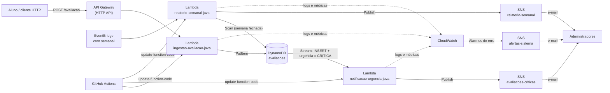
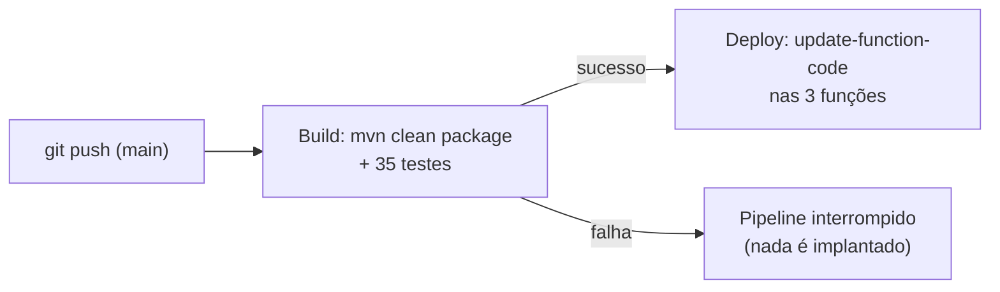

# Plataforma de Feedback de Aulas — Tech Challenge Fase 4


Plataforma **serverless na AWS** para receber avaliações de aulas, avisar os administradores por e-mail quando uma avaliação é crítica e enviar um relatório semanal consolidado. Projeto do **Tech Challenge da Fase 4** da pós-graduação em Arquitetura de Sistemas em Java (FIAP Postech).

> **Vídeo de demonstração:** **https://youtu.be/lgmgmVumBzc**<br>
  **repositório:** **https://github.com/jorgejaujr/fiap-postech-java-fase4**

---

## Sumário

1. [Visão geral](#1-visão-geral)
2. [Modelo de cloud escolhido](#2-modelo-de-cloud-escolhido)
3. [Arquitetura da solução](#3-arquitetura-da-solução)
4. [Inventário de componentes AWS](#4-inventário-de-componentes-aws)
5. [Documentação das funções Lambda](#5-documentação-das-funções-lambda)
6. [Modelo de dados](#6-modelo-de-dados)
7. [Segurança e governança de acesso](#7-segurança-e-governança-de-acesso)
8. [Observabilidade e monitoramento](#8-observabilidade-e-monitoramento)
9. [Instruções de deploy](#9-instruções-de-deploy)
10. [Testes](#10-testes)
11. [Estrutura do repositório](#11-estrutura-do-repositório)
12. [Decisões técnicas, limitações e melhorias futuras](#12-decisões-técnicas-limitações-e-melhorias-futuras)
13. [Equipe e licença](#13-equipe-e-licença)

---

## 1. Visão geral

### Problema

Para garantir a qualidade dos cursos on-line, os estudantes precisam enviar feedbacks sobre as aulas e os administradores precisam acompanhar rapidamente a satisfação dos alunos, sendo avisados quando algo é crítico e recebendo um resumo periódico.

### O que o sistema faz

| Capacidade | Como funciona |
|---|---|
| **Receber avaliações** | `POST /avaliacao` com descrição e nota (0 a 10). A nota define a urgência. |
| **Avisar sobre itens críticos** | Toda avaliação com nota de 0 a 3 dispara automaticamente um e-mail aos administradores. |
| **Relatório semanal** | Toda segunda-feira, às 8h (Brasília), um e-mail com a média das notas, a quantidade de avaliações por dia e por urgência, e a lista das avaliações da semana. |
| **Monitoramento** | Alarmes de erro por função, dashboard e logs com retenção definida. Falhas do sistema geram aviso automático aos administradores. |
| **Deploy automatizado** | A cada `push` na `main`, o pipeline compila, executa os testes e atualiza o código das três funções. |

### Regra de urgência

| Nota | Urgência | Efeito |
|---|---|---|
| 0 a 3 | `CRITICA` | E-mail imediato aos administradores |
| 4 a 6 | `MEDIA` | Entra no relatório semanal |
| 7 a 10 | `BAIXA` | Entra no relatório semanal |

A regra fica isolada no domínio (`Urgencia.deNota`), coberta por testes de fronteira (notas 0, 3, 4, 6, 7, 10, -1 e 11).

### Atendimento aos requisitos do enunciado

| Requisito do enunciado | Como foi atendido | Onde ver |
|---|---|---|
| Ambiente de nuvem configurado, com segurança dos dados e governança de acesso | AWS (região `us-east-2`), uma role IAM por função com permissões mínimas, usuário de deploy com uma única ação, criptografia em repouso e segredos fora do código | [Seção 7](#7-segurança-e-governança-de-acesso) |
| Componentes de suporte (banco de dados etc.) | DynamoDB (dados), SNS (e-mails), EventBridge (agendamento) | [Seção 4](#4-inventário-de-componentes-aws) |
| Deploy automatizado dos componentes atualizáveis | GitHub Actions: build, testes e `update-function-code` das três funções | [Seção 9](#9-instruções-de-deploy) |
| Aplicação monitorada | CloudWatch: alarmes, dashboard e retenção de logs | [Seção 8](#8-observabilidade-e-monitoramento) |
| Notificações automáticas aos administradores para problemas críticos | Duas camadas: avaliações críticas (negócio) e falhas do sistema (alarmes) | [Seção 8](#8-observabilidade-e-monitoramento) |
| Relatório semanal com média das avaliações | Lambda agendada pelo EventBridge, com média, quantidade por dia e por urgência e a lista | [Seção 5.3](#53-relatorio-semanal-java) |
| Serverless obrigatório | Três funções AWS Lambda | [Seção 5](#5-documentação-das-funções-lambda) |
| Rodar em ambiente cloud | Tudo executa na AWS | [Seção 2](#2-modelo-de-cloud-escolhido) |
| Mínimo de duas funções, com responsabilidade única | Três funções, cada uma com um único motivo para mudar | [Seção 3.4](#34-separação-de-responsabilidades) |

---

## 2. Modelo de cloud escolhido

### 2.1 Nuvem pública, AWS, região `us-east-2` (Ohio)

Usamos a **nuvem pública da AWS**. Todos os recursos ficam em uma única região (`us-east-2`), o que evita latência e custo de tráfego entre regiões e simplifica as permissões.

### 2.2 Serverless (FaaS), orientado a eventos

O modelo é **Function as a Service**: o código roda em funções AWS Lambda, e a AWS cuida de servidores, sistema operacional, escalabilidade e disponibilidade. Os componentes de apoio também são gerenciados (DynamoDB, SNS, EventBridge, API Gateway, CloudWatch).

**Por que serverless para este problema:**

| Característica do problema | Como o serverless ajuda |
|---|---|
| Carga **imprevisível e irregular** (feedbacks chegam em rajadas após as aulas) | Escala automaticamente, inclusive para zero |
| **Créditos de nuvem limitados** (previsto no enunciado) | Cobrança por execução: sem uso, sem custo de computação |
| Tarefas **disparadas por eventos** (chegada de feedback, item crítico, hora do relatório) | Lambda reage nativamente a HTTP, stream de banco e agendamento |
| Pequena equipe, **pouco tempo de operação** | Sem servidores para configurar, atualizar ou monitorar |
| Exigência de **funções com responsabilidade única** | Cada função é implantada, configurada e monitorada de forma independente |

**Pontos de atenção do modelo** (tratados nas seções de limitações): *cold start* de Java na primeira invocação, limite de tempo de execução, e entrega de eventos "pelo menos uma vez" (*at-least-once*).

### 2.3 Responsabilidade compartilhada

| Responsabilidade da AWS | Responsabilidade do projeto |
|---|---|
| Infraestrutura física, hipervisor, sistema operacional e runtime Java das Lambdas | Código das funções e suas dependências |
| Disponibilidade e criptografia em repouso gerenciada do DynamoDB | Permissões IAM, quem pode acessar o quê |
| Entrega do SNS e do EventBridge | Dados gravados, o que é logado e por quanto tempo |
| Escalabilidade dos serviços | Configuração (memória, timeouts, gatilhos, alarmes) |

### 2.4 Equivalência em outras nuvens

A arquitetura não depende de recursos exclusivos da AWS. Os mesmos papéis existem nas outras nuvens avaliadas durante o estudo:

| Papel | AWS (usado) | Azure | Google Cloud |
|---|---|---|---|
| Função serverless | Lambda | Azure Functions | Cloud Functions / Cloud Run |
| Porta de entrada HTTP | API Gateway | API Management / HTTP trigger | API Gateway |
| Banco NoSQL | DynamoDB | Cosmos DB | Firestore |
| Notificação por e-mail / mensageria | SNS | Event Grid / Service Bus (e-mail via serviço de comunicação) | Pub/Sub |
| Agendamento | EventBridge | Timer trigger | Cloud Scheduler |
| Monitoramento | CloudWatch | Azure Monitor | Cloud Monitoring |

### 2.5 Alternativas descartadas

| Alternativa | Motivo de não usar |
|---|---|
| Máquinas virtuais (EC2) ou contêineres (ECS/Fargate) | Custo fixo mesmo sem uso, mais operação e menos aderência ao enunciado |
| Banco relacional (RDS) | Custo e operação maiores sem necessidade: o acesso é por chave e por período, com poucos relacionamentos |
| E-mail direto pelo SES | O SNS atende ao caso com menos configuração e permite múltiplos assinantes |

---

## 3. Arquitetura da solução

### 3.1 Diagrama



### 3.2 Fluxo 1 — Ingestão

1. O cliente envia `POST /avaliacao` com `descricao` e `nota`.
2. O API Gateway aciona a Lambda de ingestão.
3. A função valida o corpo, calcula a urgência pela regra do domínio e grava o item no DynamoDB com `id`, `descricao`, `nota`, `urgencia`, `dataEnvio` e `dia`.
4. Responde `201` com o identificador e a urgência, ou `400` para entrada inválida, ou `500` se a gravação falhar.

### 3.3 Fluxo 2 — Notificação (assíncrono, por evento)

1. A gravação no DynamoDB gera um registro no **DynamoDB Stream** (imagem nova do item).
2. O gatilho da Lambda de notificação tem um **filtro de evento**: só passam registros `INSERT` com `urgencia = CRITICA`. Avaliações médias e baixas **nem invocam** a função (menos custo e menos código).
3. A função monta o e-mail com **descrição, urgência e data de envio** e publica no tópico `avaliacoes-criticas`.
4. O SNS entrega o e-mail aos administradores inscritos.

A Lambda de ingestão não sabe que a notificação existe: as duas funções se comunicam apenas pelo evento do banco.

### 3.4 Separação de responsabilidades

| Função | Única responsabilidade | Por que não está junta de outra |
|---|---|---|
| `ingestao-avaliacao-java` | Receber, validar e persistir avaliações | A resposta ao aluno não pode esperar o envio de e-mail, e uma falha de e-mail não pode impedir o registro da avaliação |
| `notificacao-urgencia-java` | Alertar os administradores sobre avaliações críticas | Reage a eventos do banco, com ritmo e permissões diferentes da API |
| `relatorio-semanal-java` | Consolidar e enviar o relatório periódico | Roda por agendamento, lê dados em lote e tem timeout e permissões próprios |

Todas compartilham o mesmo domínio (`Urgencia`, `Avaliacao`, regras de relatório e formatação), que é código puro, sem dependência da AWS e coberto por testes. O projeto gera **um único `.jar`** com os três *handlers*; cada função aponta para o seu handler e é configurada e implantada de forma independente.

### 3.5 Fluxo 3 — Relatório semanal

1. O EventBridge dispara a função toda **segunda-feira às 8h de Brasília** (`cron(0 11 ? * MON *)`, em UTC).
2. A função calcula a **semana fechada**: os 7 dias que terminam na véspera da execução (de segunda a domingo). Avaliações do dia da execução ficam para o relatório seguinte.
3. Lê as avaliações do período (scan paginado com filtro por `dia`), calcula média, contagem por dia e por urgência, e ordena da mais recente para a mais antiga.
4. Publica o relatório no tópico `relatorio-semanal`.

---

## 4. Inventário de componentes AWS

Região: **us-east-2 (Ohio)**.

| Tipo | Nome | Função no sistema |
|---|---|---|
| API Gateway (HTTP API) | ingestao-avaliacao-java-API | Expõe `POST /avaliacao` e aciona a Lambda de ingestão |
| Lambda | `ingestao-avaliacao-java` | Ingestão de avaliações |
| Lambda | `notificacao-urgencia-java` | Notificação de avaliações críticas |
| Lambda | `relatorio-semanal-java` | Relatório semanal |
| DynamoDB | `avaliacoes` | Armazena as avaliações (stream habilitado, imagem nova) |
| SNS | `avaliacoes-criticas` | E-mail de urgência aos administradores |
| SNS | `relatorio-semanal` | E-mail do relatório semanal |
| SNS | `alertas-sistema` | E-mail de falhas do sistema (alarmes) |
| EventBridge | regra semanal (`cron(0 11 ? * MON *)`) | Dispara o relatório |
| CloudWatch | alarmes `alarme-erros-ingestao`, `alarme-erros-notificacao`, `alarme-erros-relatorio` | Detectam falhas das funções |
| CloudWatch | painel `plataforma-feedback` | Visão consolidada de invocações, erros e duração |
| IAM | uma role por função + usuário `github-deploy` | Governança de acesso (ver seção 7) |
| GitHub Actions | `.github/workflows/deploy.yml` | Build, testes e deploy |

---

## 5. Documentação das funções Lambda

Configuração comum: **runtime Java 21**, arquitetura x86_64, mesmo artefato `projetoFase4-0.0.1-SNAPSHOT.jar`.

### 5.1 `ingestao-avaliacao-java`

**Responsabilidade:** receber `POST /avaliacao`, validar, classificar a urgência e gravar no DynamoDB.

| Item | Valor |
|---|---|
| Handler | `br.com.fiap.projetofase4.entrypoint.ingestao.IngestaoHandler::handleRequest` |
| Gatilho | API Gateway HTTP API, rota `POST /avaliacao` |
| Memória / timeout | 512 MB / 15 s |
| Variáveis de ambiente | nenhuma (a tabela é `avaliacoes`) |
| Permissões (role) | logs + `dynamodb:PutItem` na tabela `avaliacoes` |

**Contrato da API**

Requisição:

```json
POST /avaliacao
Content-Type: application/json

{
  "descricao": "Aula muito boa, explicação clara",
  "nota": 9
}
```

| Campo | Tipo | Regra |
|---|---|---|
| `descricao` | texto | obrigatório, não pode ser vazio |
| `nota` | inteiro | obrigatório, de 0 a 10 |

Respostas (corpo em texto simples):

| Status | Quando | Corpo |
|---|---|---|
| `201` | Avaliação gravada | `Avaliação registrada: <id> (<URGENCIA>)` |
| `400` | Corpo vazio | `Corpo de requisição vazio` |
| `400` | JSON malformado | `JSON Inválido` |
| `400` | Descrição ausente ou vazia | `descricao é obrigatória` |
| `400` | Nota ausente ou fora de 0 a 10 | `nota deve estar entre 0 e 10` |
| `500` | Falha ao gravar no DynamoDB | `Erro ao gravar a avaliacao` |

Exemplos de chamada (substitua `<URL_DA_API>` pela URL do estágio da API):

```bash
curl -X POST "<URL_DA_API>/avaliacao" \
  -H "Content-Type: application/json" \
  -d '{"descricao":"Aula confusa, não consegui acompanhar","nota":2}'
```

```powershell
Invoke-RestMethod -Method Post -Uri "<URL_DA_API>/avaliacao" `
  -ContentType "application/json" `
  -Body '{"descricao":"Aula confusa, não consegui acompanhar","nota":2}'
```

> O enunciado cita `POST /avaliação`. Na implementação a rota usa o nome sem acento (`/avaliacao`), prática comum em URLs.

### 5.2 `notificacao-urgencia-java`

**Responsabilidade:** enviar o e-mail de urgência quando uma avaliação crítica é gravada.

| Item | Valor |
|---|---|
| Handler | `br.com.fiap.projetofase4.entrypoint.notificacao.NotificacaoHandler::handleRequest` |
| Gatilho | DynamoDB Stream da tabela `avaliacoes` |
| Filtro do gatilho | `INSERT` com `urgencia = CRITICA` (ver abaixo) |
| Configuração do gatilho | tamanho do lote **1**, tentativas máximas **2**, idade máxima do registro **1 hora**, posição inicial `LATEST` |
| Memória / timeout | 512 MB / 15 s |
| Variável de ambiente | `TOPIC_ARN` — ARN do tópico `avaliacoes-criticas` |
| Permissões (role) | logs + leitura do stream + `sns:Publish` no tópico `avaliacoes-criticas` |

Filtro de evento do gatilho:

```json
{
  "eventName": ["INSERT"],
  "dynamodb": { "NewImage": { "urgencia": { "S": ["CRITICA"] } } }
}
```

**E-mail enviado** (assunto sem acentos, exigência do SNS):

```
Assunto: [CRITICA] Nova avaliacao recebida

Uma nova avaliação foi recebida e precisa de atenção.

Descrição: Aula confusa, não consegui acompanhar
Urgência: CRITICA
Data de envio: 12/11/2026 14:06
ID da avaliação: 3f2a...
```

**Comportamento defensivo:**
- registro sem `id` é ignorado (log) — não adianta repetir um dado quebrado;
- `descricao` ausente vira `(sem descrição)` e `dataEnvio` ausente vira `não informada`, para que o alerta **nunca** deixe de sair por dado incompleto;
- falha ao publicar no SNS é registrada e **relançada**, para contar como erro na métrica (alimenta o alarme) e permitir nova tentativa;
- lote de tamanho 1 evita reenvio de e-mails já entregues quando uma nova tentativa ocorre.

### 5.3 `relatorio-semanal-java`

**Responsabilidade:** gerar e enviar o relatório semanal consolidado.

| Item | Valor |
|---|---|
| Handler | `br.com.fiap.projetofase4.entrypoint.relatorio.RelatorioHandler::handleRequest` |
| Gatilho | EventBridge, regra semanal `cron(0 11 ? * MON *)` (segunda, 8h de Brasília) |
| Memória / timeout | 512 MB / 60 s |
| Variável de ambiente | `TOPIC_ARN_RELATORIO` — ARN do tópico `relatorio-semanal` |
| Permissões (role) | logs + `dynamodb:Scan` na tabela `avaliacoes` + `sns:Publish` no tópico `relatorio-semanal` |

**Conteúdo do e-mail** (exemplo ilustrativo):

```
Assunto: Relatorio semanal de avaliacoes - 07/11/2026 a 13/11/2026

Relatório semanal de avaliações
Período: 07/11/2026 a 13/11/2026

Total de avaliações: 4
Média das notas: 5,50

Avaliações por dia:
  07/11/2026: 0
  08/11/2026: 0
  09/11/2026: 0
  10/11/2026: 1
  11/11/2026: 0
  12/11/2026: 1
  13/11/2026: 2

Avaliações por urgência:
  CRITICA: 1
  MEDIA: 2
  BAIXA: 1

Avaliações da semana (mais recentes primeiro):
  [MEDIA] 13/11/2026 08:00 - Segunda página do scan (nota 6)
  [CRITICA] 12/11/2026 10:15 - Aula confusa, não consegui acompanhar (nota 2)
  [BAIXA] 10/11/2026 17:00 - Muito boa! (nota 9)
  [MEDIA] não informada - (sem descrição) (nota 5)
```

**Regras do relatório:**
- período: semana fechada, calculada no fuso `America/Sao_Paulo`;
- todos os dias do período aparecem, inclusive com zero; as três urgências aparecem sempre, da mais grave para a menos grave;
- sem avaliações no período, a média aparece como `-` (e não `0,00`, que enganaria);
- itens com nota ausente ou fora de 0 a 10 são ignorados e registrados em log;
- a lista mostra no máximo **50** avaliações, com descrição cortada em **200** caracteres; o excedente é informado ("... e mais N avaliação(ões) não listada(s)");
- a leitura do banco usa paginação (`scanPaginator`), contornando o limite de 1 MB por chamada do Scan.

---

## 6. Modelo de dados

Tabela DynamoDB **`avaliacoes`**: chave de partição `id` (texto), capacidade **sob demanda**, **stream habilitado** (tipo *imagem nova*).

| Atributo | Tipo | Exemplo | Observação |
|---|---|---|---|
| `id` | S (chave) | `3f2a8c...` | UUID gerado na ingestão |
| `descricao` | S | `Aula confusa` | texto enviado pelo aluno |
| `nota` | N | `2` | 0 a 10 |
| `urgencia` | S | `CRITICA` | `CRITICA`, `MEDIA` ou `BAIXA` |
| `dataEnvio` | S | `2026-11-12T14:06:06.987-03:00` | ISO-8601 com offset de São Paulo |
| `dia` | S | `2026-11-12` | data local de São Paulo, usada no filtro do relatório |

**Nota sobre o campo `dia`:** versões iniciais da ingestão gravaram nesse campo o carimbo completo, em vez de só a data, o que deixou a tabela com formatos misturados. A ingestão foi corrigida e o relatório passou a **aceitar os dois formatos** (normaliza para `yyyy-MM-dd` na leitura e filtra por intervalo semiaberto `dia >= início` e `dia < fim + 1 dia`), sem necessidade de editar os dados antigos.

**Por que `Scan` no relatório:** com o volume do projeto, um scan paginado com filtro é suficiente. Em produção, o caminho natural é um índice secundário global por `dia` (ver seção 12).

---

## 7. Segurança e governança de acesso

### 7.1 Princípio adotado: privilégio mínimo, uma role por função

Cada função tem a **própria role de execução**, só com o que precisa. Nenhuma usa permissões amplas.

| Função | Role | Permissões |
|---|---|---|
| Ingestão | `IngestaoRole` | `AWSLambdaBasicExecutionRole` (logs) + `dynamodb:PutItem` apenas na tabela `avaliacoes` |
| Notificação | `AvaliacoesRole` | `AWSLambdaBasicExecutionRole` + `AWSLambdaDynamoDBExecutionRole` (leitura do stream) + `sns:Publish` apenas no tópico `avaliacoes-criticas` |
| Relatório | `RelatorioRole` | `AWSLambdaBasicExecutionRole` + `dynamodb:Scan` apenas na tabela `avaliacoes` + `sns:Publish` apenas no tópico `relatorio-semanal` |

Política em linha da ingestão:

```json
{
  "Version": "2012-10-17",
  "Statement": [{
    "Effect": "Allow",
    "Action": "dynamodb:PutItem",
    "Resource": "arn:aws:dynamodb:us-east-2:<ACCOUNT_ID>:table/avaliacoes"
  }]
}
```

Política em linha da notificação (além das gerenciadas):

```json
{
  "Version": "2012-10-17",
  "Statement": [{
    "Effect": "Allow",
    "Action": "sns:Publish",
    "Resource": "arn:aws:sns:us-east-2:<ACCOUNT_ID>:avaliacoes-criticas"
  }]
}
```

Política em linha do relatório:

```json
{
  "Version": "2012-10-17",
  "Statement": [
    { "Effect": "Allow", "Action": "dynamodb:Scan",
      "Resource": "arn:aws:dynamodb:us-east-2:<ACCOUNT_ID>:table/avaliacoes" },
    { "Effect": "Allow", "Action": "sns:Publish",
      "Resource": "arn:aws:sns:us-east-2:<ACCOUNT_ID>:relatorio-semanal" }
  ]
}
```

### 7.2 Usuário do pipeline de deploy

O pipeline usa um usuário IAM dedicado, `github-deploy`, **sem acesso ao console**, com uma política de **uma única ação**, restrita às três funções:

```json
{
  "Version": "2012-10-17",
  "Statement": [{
    "Effect": "Allow",
    "Action": "lambda:UpdateFunctionCode",
    "Resource": [
      "arn:aws:lambda:us-east-2:<ACCOUNT_ID>:function:ingestao-avaliacao-java",
      "arn:aws:lambda:us-east-2:<ACCOUNT_ID>:function:notificacao-urgencia-java",
      "arn:aws:lambda:us-east-2:<ACCOUNT_ID>:function:relatorio-semanal-java"
    ]
  }]
}
```

Mesmo que a chave vazasse, quem a tivesse não leria dados, não alteraria configurações e não afetaria nenhum outro recurso.

### 7.3 Segredos

- As credenciais do pipeline ficam nos **GitHub Secrets** (`AWS_ACCESS_KEY_ID`, `AWS_SECRET_ACCESS_KEY`), nunca no repositório.
- Os ARNs dos tópicos ficam em **variáveis de ambiente** das funções, fora do código.
- O repositório não contém chaves, e-mails pessoais nem o identificador da conta. O `.gitignore` bloqueia arquivos de credenciais (`*.csv`, `*.pem`, `.env`) e o GitHub **Push Protection** rejeita envios que contenham segredos. Esse mecanismo foi acionado durante o desenvolvimento ao tentar subir, por engano, um CSV de credenciais; o envio foi bloqueado, o histórico local foi corrigido e a chave foi **substituída**.

### 7.4 Dados dos clientes

| Medida | Situação |
|---|---|
| Criptografia **em repouso** | DynamoDB criptografa todas as tabelas por padrão |
| Criptografia **em trânsito** | A API é acessada por HTTPS e as chamadas entre serviços usam TLS |
| Minimização | Só são gravados descrição, nota e datas; **não há dados de identificação do aluno** |
| Logs | As funções registram identificadores e erros, **não o conteúdo das avaliações** |
| Retenção de logs | **2 semanas**, evitando acúmulo indefinido |
| Destinatários dos e-mails | Apenas as assinaturas confirmadas nos tópicos SNS |

### 7.5 Limitações conhecidas de segurança

- A API **não exige autenticação**: o enunciado não define uma, e isso facilita a avaliação. Para produção, as opções são Amazon Cognito (JWT authorizer), chave de API e limitação de requisições (*throttling*) no API Gateway.
- A política gerenciada `AWSLambdaDynamoDBExecutionRole` dá permissão de leitura de streams de forma ampla. Restringi-la ao stream da tabela `avaliacoes` é um refinamento previsto.
- A descrição é texto livre do aluno e pode conter dado pessoal. Uma política de retenção da tabela (TTL) é uma melhoria sugerida.

---

## 8. Observabilidade e monitoramento

### 8.1 Duas camadas de notificação aos administradores

| Camada | Tipo de problema | Mecanismo | Tópico SNS |
|---|---|---|---|
| **Negócio** | Avaliação crítica de um aluno | Stream do DynamoDB, Lambda de notificação | `avaliacoes-criticas` |
| **Sistema** | Falha em alguma função | Alarmes do CloudWatch | `alertas-sistema` |

### 8.2 Alarmes

| Alarme | Função monitorada | Métrica | Condição |
|---|---|---|---|
| `alarme-erros-ingestao` | `ingestao-avaliacao-java` | `Errors` (Lambda) | Soma ≥ 1 em 5 minutos |
| `alarme-erros-notificacao` | `notificacao-urgencia-java` | `Errors` (Lambda) | Soma ≥ 1 em 5 minutos |
| `alarme-erros-relatorio` | `relatorio-semanal-java` | `Errors` (Lambda) | Soma ≥ 1 em 5 minutos |

- Dados ausentes são tratados como "bons" (sem invocações não há alarme).
- A ação do estado **Em alarme** (e, se configurado, do estado **OK**) publica em `alertas-sistema`, que envia e-mail aos administradores.
- O alarme foi **validado na prática**: provocamos uma falha na função de relatório (variável de ambiente removida), o alarme entrou em *Em alarme*, o e-mail chegou e, após a correção, o alarme voltou a *OK*.

### 8.3 Dashboard

Painel `plataforma-feedback` com: invocações, erros e duração (mostra o *cold start* do Java) das três funções, requisições e erros `5xx` do API Gateway, e o status dos alarmes.

### 8.4 Logs

- Cada função grava em seu grupo de logs (`/aws/lambda/<nome-da-função>`).
- Retenção configurada de **2 semanas**.
- Os handlers registram o início do processamento, quantidades processadas e falhas (por exemplo, "Total de avaliações encontradas: N" e "Relatório enviado com sucesso.").

---

## 9. Instruções de deploy

### 9.1 Pré-requisitos

- Conta AWS com permissão para criar os recursos (Lambda, DynamoDB, SNS, EventBridge, API Gateway, CloudWatch e IAM).
- JDK 21 e Maven 3.9+ (para build local).
- Um e-mail de administrador para as assinaturas SNS.
- Repositório no GitHub com o pipeline habilitado.

### 9.2 Provisionamento inicial (uma vez, pelo console)

O pipeline atualiza o **código** das funções. Os recursos abaixo são criados **uma vez**, na região `us-east-2`, nesta ordem:

1. **DynamoDB** — tabela `avaliacoes`, chave de partição `id` (String), capacidade sob demanda. Em *Exportações e streams*, **ativar o stream** com tipo *imagem nova*.
2. **SNS** — criar os tópicos padrão `avaliacoes-criticas`, `relatorio-semanal` e `alertas-sistema`; em cada um, criar a assinatura de e-mail e **confirmar** pelo link recebido. Anotar os ARNs.
3. **IAM** — criar as três roles (seção 7.1), uma por função, com as políticas descritas.
4. **Build do artefato** — `mvn clean package`; o arquivo gerado é `target/projetoFase4-0.0.1-SNAPSHOT.jar`.
5. **Lambda** — criar as três funções (runtime Java 21, x86_64), enviar o jar, configurar **handler, memória, timeout e role** conforme a seção 5, e definir as **variáveis de ambiente** (`TOPIC_ARN` na notificação e `TOPIC_ARN_RELATORIO` no relatório).
6. **Gatilhos:**
   - **Ingestão:** API Gateway, HTTP API, rota `POST /avaliacao` apontando para a função.
   - **Notificação:** DynamoDB, stream da tabela `avaliacoes`, posição inicial `LATEST`, lote 1, tentativas máximas 2, idade máxima 1 hora e o filtro de evento da seção 5.2.
   - **Relatório:** EventBridge, regra de agendamento `cron(0 11 ? * MON *)` (UTC) apontando para a função.
7. **Monitoramento** — criar o painel, os três alarmes (seção 8.2) apontando para `alertas-sistema` e a retenção dos grupos de log.
8. **Pipeline** — criar o usuário `github-deploy` com a política da seção 7.2, gerar a chave de acesso e cadastrar os segredos `AWS_ACCESS_KEY_ID` e `AWS_SECRET_ACCESS_KEY` em *Settings → Secrets and variables → Actions*.

### 9.3 Pipeline de deploy automatizado

Arquivo: [`.github/workflows/deploy.yml`](.github/workflows/deploy.yml).

| Etapa | O que faz |
|---|---|
| **Gatilho** | `push` na `main` e execução manual (`workflow_dispatch`) |
| **Job `build`** | Java 21 (Temurin), `mvn -B clean package`: compila, **executa os 35 testes** e gera o jar com as dependências (*shade*). Se algum teste falhar, o deploy não acontece |
| **Job `deploy`** | Roda só após o build com sucesso e na `main`. Autentica na AWS com os segredos e executa `aws lambda update-function-code` nas três funções, com o mesmo jar |



**O que o pipeline cobre e o que não cobre:** atualiza o **código**. Handler, memória, variáveis de ambiente, gatilhos e alarmes são configurados no provisionamento inicial. Versionar essa infraestrutura como código está listado como melhoria futura.

### 9.4 Como fazer um deploy

1. Faça a alteração e rode `mvn clean package` localmente.
2. `git commit` e `git push origin main`.
3. Acompanhe na aba **Actions** do GitHub. Ao final, a data de **Última modificação** de cada função muda no console da AWS.

Também é possível disparar manualmente: **Actions → Build e Deploy → Run workflow**.

### 9.5 Rollback

Faça `git revert` do commit problemático e `git push`: o pipeline reimplanta a versão anterior do código nas três funções.

### 9.6 Remoção dos recursos (para evitar custos)

Apague, nesta ordem: gatilhos e regras do EventBridge, funções Lambda, API, alarmes e painel, tópicos SNS, tabela DynamoDB, roles IAM, e desative e exclua a chave do usuário `github-deploy`.

---

## 10. Testes

### 10.1 Testes automatizados

**35 testes unitários** (JUnit 5), executados em todo build e em todo deploy:

| Classe de teste | Testes | O que valida |
|---|---|---|
| `UrgenciaTest` | 8 | Faixas de urgência e **valores de fronteira** (0, 3, 4, 6, 7, 10) e notas inválidas (-1, 11) |
| `RelatorioServiceTest` | 10 | Média, contagem por dia e por urgência, lista vazia ou nula, ordenação por data (misturando UTC e -03:00) |
| `FormatadorDataTest` | 8 | Conversão de fuso, datas inválidas ou ausentes, normalização do campo `dia` |
| `MontadorRelatorioTest` | 9 | Conteúdo do e-mail: relatório vazio, média com vírgula, ordem das urgências, dias com zero, lista, corte de descrição e limite de 50 itens |

Executar localmente:

```bash
mvn clean test       # só os testes
mvn clean package    # testes + jar
```

O domínio é código puro (sem dependência da AWS), o que permite testá-lo sem nuvem. Os handlers e o repositório são camadas finas de integração, validadas nos testes ponta a ponta abaixo.

### 10.2 Teste ponta a ponta

| # | Ação | Resultado esperado |
|---|---|---|
| 1 | `POST` com nota **9** | `201`; item gravado com `urgencia = BAIXA`; **nenhum** e-mail |
| 2 | `POST` com nota **5** | `201`; `MEDIA`; nenhum e-mail |
| 3 | `POST` com nota **2** | `201`; `CRITICA`; **e-mail de urgência** em poucos segundos |
| 4 | `POST` com nota **11** | `400` e nada gravado |
| 5 | `POST` sem `descricao` | `400` |
| 6 | `POST` com JSON quebrado ou corpo vazio | `400` |
| 7 | Executar a função de relatório (teste `{}` ou regra de agendamento) | E-mail do relatório com média, contagens e lista |
| 8 | Provocar falha na função (ex.: remover a variável `TOPIC_ARN_RELATORIO` e executar) | Alarme entra em *Em alarme* e e-mail chega em `alertas-sistema` |
| 9 | `git push` na `main` | Pipeline executa build, testes e atualiza as três funções |

> O relatório cobre a **semana fechada** (até ontem). Avaliações enviadas hoje só aparecem no relatório seguinte.

---

## 11. Estrutura do repositório

```
.
├── .github/workflows/deploy.yml        # pipeline: build, testes e deploy
├── pom.xml                             # Java 21, SDK AWS v2, shade, JUnit 5
├── LICENSE
└── src
    ├── main/java/br/com/fiap/projetofase4
    │   ├── domain                      # regras puras, sem AWS
    │   │   ├── model                   # Avaliacao, Urgencia
    │   │   ├── exception               # AvaliacaoInvalidaException
    │   │   └── service                 # RelatorioService, MontadorRelatorio, FormatadorData
    │   ├── infrastructure/dynamodb     # AvaliacaoRepository (leitura do relatório)
    │   └── entrypoint                  # o que a AWS invoca (handlers finos)
    │       ├── ingestao                # IngestaoHandler
    │       ├── notificacao             # NotificacaoHandler
    │       └── relatorio               # RelatorioHandler
    └── test/java/br/com/fiap/projetofase4   # espelha a estrutura de main
```

A organização segue a **Clean Architecture**: o domínio não conhece a AWS, os *handlers* só recebem o evento e delegam, e a infraestrutura isola o acesso ao DynamoDB. Isso é o que permitirá trocar o *handler* por um baseado em Quarkus sem tocar nas regras de negócio.

---

## 12. Decisões técnicas, limitações e melhorias futuras

### 12.1 Decisões

| Decisão | Motivo |
|---|---|
| Java puro agora, Quarkus como evolução | Entender o ciclo Lambda/AWS antes de adicionar o framework; o domínio isolado torna a migração barata |
| DynamoDB em vez de banco relacional | Acesso por chave e por período, sem relacionamentos, custo por uso |
| Stream com **filtro de evento** para a notificação | Desacopla a ingestão do e-mail e só invoca a função para itens críticos |
| Tópicos SNS separados (críticas, relatório, sistema) | Públicos, frequências e motivos diferentes |
| Semana fechada no relatório | Resultado estável e reproduzível, sem dia incompleto |
| Fuso `America/Sao_Paulo` em todas as datas | Dia do aluno coerente com o dia do relatório (a Lambda roda em UTC) |
| Um jar, três handlers | Domínio compartilhado e pipeline simples; cada função continua independente |
| Lote 1 no stream | Evita e-mails duplicados em novas tentativas |

### 12.2 Limitações conhecidas

- **Cold start do Java:** a primeira invocação de cada função leva alguns segundos.
- **Entrega *at-least-once*:** o stream e o SNS podem, em raros casos, entregar mais de uma vez.
- **Infraestrutura criada manualmente:** o pipeline versiona o código, não os recursos.
- **API sem autenticação** (ver seção 7.5) e sem limitação de requisições configurada.
- **Nome da tabela fixo no código** (`avaliacoes`), em vez de variável de ambiente.
- **Sem fila de mensagens não entregues (DLQ)** para a notificação.
- **Scan** no relatório: adequado ao volume atual, mas cresce com a tabela.

### 12.3 Melhorias futuras

1. **Infraestrutura como código** (AWS SAM, CDK ou Terraform) para recriar todo o ambiente com um comando.
2. **Migração do *handler* para Quarkus** e avaliação de SnapStart ou imagem nativa para reduzir o cold start; troca do cliente HTTP do SDK por `url-connection-client`.
3. **Autenticação** com Amazon Cognito e *throttling* no API Gateway.
4. **Índice secundário global** por `dia` para o relatório, no lugar do scan.
5. **DLQ** e idempotência na notificação.
6. **TTL** na tabela para retenção dos dados.
7. **Políticas ainda mais restritas** (stream da tabela e não leitura ampla de streams).
8. **Ambientes separados** (dev e prod) com aprovação manual no deploy de produção.

---

## 13. Equipe e licença

**Equipe:** <br>
* **Gustavo Roseira Nunes - RM370333**<br>
* **Jorge Ricardo Jaú Junior - RM370999**<br>
* **Rafael Moura Gonçalves - RM371156**<br>
* **Everton Mota da Costa -  RM372199**<br>
* **Edvaldo Batista de Albuquerque Júnior - RM370773**

Projeto acadêmico desenvolvido para a pós-graduação em Arquitetura de Sistemas em Java da FIAP (Postech), Fase 4. Distribuído sob a licença **GNU General Public License v3.0 (GPL-3.0)**.
O texto completo está no arquivo [`LICENSE`](LICENSE) e também em
<https://www.gnu.org/licenses/gpl-3.0.html>.